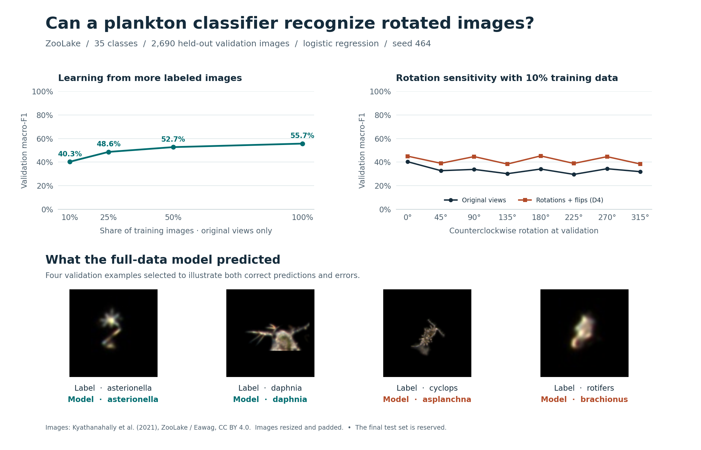

# Legacy: first ZooLake baseline on the provider split

This is the team's first implementation. It uses the provider's train/val/test lists, which the grouped study rejected because capture groups cross the folds. It is kept as a reference only. Current work lives in [`zoolake-grouped`](../zoolake-grouped/README.md).

**Grouped morphology experiment.** Adding 31 image-derived shape and texture features raised full-training validation macro-F1 from **0.5275 to 0.6169** on one frozen, three-minute grouped split. The repository-root baseline scored **0.5253** when refit on those same folds. The rest of this page describes the original provider-split experiment. [Paired results, predictions and reproduction commands](../zoolake-grouped/results/morphology/README.md)

Can a classifier recognize the same plankton after a rotation, and how much labeled data does it need? This first experiment transfers the proposal's questions to ZooLake. It trains a multinomial logistic regression on image features and measures sample efficiency and rotation sensitivity.



## Try the trained model

From this directory, use Python 3.12 and install the dependencies, ideally in a virtual environment.

```sh
python -m pip install -r requirements.txt
python predict.py results/demo.jpeg
```

The bundled example is an original validation JPEG labeled `asterionella`. The full-data baseline ranks that class first (95.8% model probability). Pass another image path to see its three highest-scoring classes. Both inference and the overview above work without downloading the training archive.

## Initial results

All scores use the same **2,690 validation images** and all 35 labels. Macro-F1 averages the class-level F1 scores equally. Accuracy counts individual correct predictions.

| Original training images | Training views per image | Macro-F1 at 0° | Accuracy at 0° |
| ---: | --- | ---: | ---: |
| 1,258 (10%) | Original | 0.403 | 66.2% |
| 1,258 (10%) | Eight rotations/reflections (D4) | 0.450 | 71.9% |
| 3,144 (25%) | Original | 0.486 | 73.2% |
| 6,288 (50%) | Original | 0.527 | 76.5% |
| 12,557 (100%) | Original | 0.557 | 79.6% |

At **90°**, the two 10% models score **0.338** and **0.447** macro-F1 respectively. Predictions agree with their own 0° predictions on **63.8%** and **94.6%** of images. Agreement measures consistency and includes consistently wrong answers. At 45°, D4 reaches 0.390 macro-F1, below its 0.450 on unrotated images. These are single-seed validation results. Test evaluation, CNN experiments and the three-seed comparison are future work.

## Data and evaluation protocol

- Use the public original ZIP linked by the [ZooLake dataset card](https://huggingface.co/datasets/project-oceania/zoolake). It contains 17,943 RGB JPEGs from Lake Greifensee in 35 labeled categories. Image widths span 16–2,832 pixels and heights span 20–2,176 pixels.
- Read the authors' train/validation/test filename lists. Hash decoded pixels and dimensions. Three pairs share identical pixels and conflicting labels. The lists repeat one path per pair and omit its other copy. Exclude all six records and keep every other published assignment. Final split sizes are **12,557 / 2,690 / 2,690**, approximately 70/15/15. The test split participates in inventory and duplicate checks only.
- Training counts range from 7 (`chaoborus`) to 2,364 (`dinobryon`). The full-data baseline has zero F1 in six classes. Five of those have at most three validation samples each. A new lake or capture period would require separate evaluation.
- Make one seeded permutation per training class (seed 464). For each budget take a prefix of each permutation, rounding to the nearest whole image with a minimum of one. Each larger budget contains all samples from the smaller budgets. The saved within-class ranks identify each prefix.
- Resize each full image with bilinear interpolation and preserve its aspect ratio. Center on a black 128 × 128 canvas, scaling the image diagonal to 126 pixels to leave room for rotation. Extract 324 HOG edge-orientation values, 48 foreground RGB histogram bins and seven log-transformed absolute Hu shape moments. Otsu thresholding defines the foreground for color and shape.
- Fit a standard scaler on the selected training views, then train L2-regularized multinomial logistic regression with L-BFGS, `C=0.1`, tolerance `1e-5`, and at most 800 iterations. No class weighting or hyperparameter search. The 10% D4 run uses four quarter turns, each with and without reflection. Its 10,064 rows carry weight 1/8 each, keeping the total weight per original equal across the two 10% runs.
- Score one view per validation image at each angle from 0° to 315° in 45° steps. Quarter turns permute pixels exactly. Other angles use bilinear interpolation and black fill. Compare each rotated prediction with the same model's original prediction for agreement. Diagonal-angle measurements include the effect of interpolation.

## Reproduce the experiment

Download the original archive into `data/` using these commands from the project directory. On Windows PowerShell, use `curl.exe` for the download command.

```sh
mkdir data
curl -fL --retry 2 -o data/zoolake.zip https://opendata.eawag.ch/dataset/52b6ba86-5ecb-448c-8c01-eec7cb209dc7/resource/1cc785fa-36c2-447d-bb11-92ce1d1f3f2d/download/data.zip
python train.py --archive data/zoolake.zip --out results --seed 464
python plot_results.py --archive data/zoolake.zip --results results
```

The trainer verifies the archive SHA-256 and reads images directly from the ZIP. The run used a CPU, Python 3.12.14, OpenCV for features and scikit-learn for fitting. Exact run versions are recorded in [run metadata](results/run.json).

| Artifact | Contents |
| --- | --- |
| [Class counts](results/class_counts.csv), [manifest](results/manifest.csv), [excluded records](results/excluded.csv) | Every class, cleaned split, training rank, original size and duplicate decision |
| [Learning curve](results/learning_curve.csv), [rotation results](results/rotations.csv) | Validation metrics by training budget, augmentation and evaluation angle |
| [Per-class scores](results/per_class.csv), [confusion matrix](results/confusion.csv) | Original-view precision, recall and F1 per run, plus the full baseline's matrix (rows are actual labels) |
| [Validation predictions](results/validation_predictions.csv) | One row per validation image. Columns identify the training run and evaluation angle |
| [Saved baseline](results/baseline.npz), [demo image](results/demo.jpeg) | Numeric model weights, scaling parameters and class order, with one validation image to try |

## Data credit

ZooLake images and labels are by S. P. Kyathanahally and colleagues, Eawag, distributed under [CC BY 4.0](https://creativecommons.org/licenses/by/4.0/). The demo JPEG is an unmodified dataset image. The overview shows resized, padded copies. [Original paper](https://doi.org/10.3389/fmicb.2021.746297) · [Eawag project](https://www.eawag.ch/en/department/siam/projects/plankifier/) · [Hugging Face dataset card](https://huggingface.co/datasets/project-oceania/zoolake).
