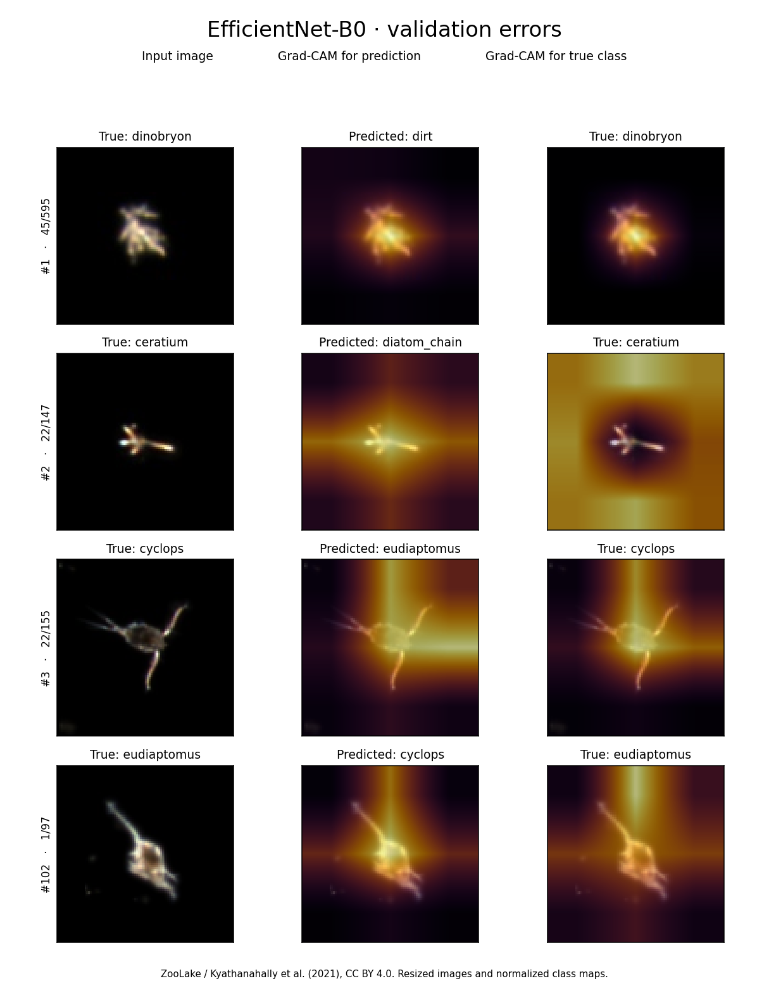

# Morphology on the shared ZooLake folds

Adding 31 shape and texture measurements improved validation macro-F1 in all three classical classifiers. Logistic regression had the highest macro-F1 among these fits. XGBoost had the highest accuracy. All runs used the same 35 labels and the same 2,690 validation images.

| Full-training model | Control macro-F1 | With morphology | Change | Minority macro-F1, control → morphology | Accuracy, control → morphology |
| --- | ---: | ---: | ---: | ---: | ---: |
| Logistic regression | 0.5112 | **0.6333** | +0.1221 | 0.1427 → 0.3348 | 69.26% → 78.81% |
| RBF-SVM | 0.5133 | **0.6159** | +0.1026 | 0.1494 → 0.2892 | 73.87% → 80.63% |
| XGBoost | 0.5289 | **0.6222** | +0.0933 | 0.1304 → 0.2599 | 74.46% → 82.04% |

We restored the 6,162 three-minute assignments from the [root fold map](../../../folds.csv) using `--fold-map`. The portable SHA-256 over image identities, labels, folds and nested training subsets is `686731c225aaa96ee13bcbeaf29035a3eee08541a2d15e59ee450d840e0e83fc`. It matches Mert's [original study identity](../final-study/test/split_identity.json). There are 12,556 training images. The 2,691 final-test images stayed outside fitting, scoring and Grad-CAM selection throughout this work.

Within each pair we kept the model, training rows, class weights, 128-pixel preprocessing and single-view inference fixed. The extended model uses 135 features, including the 104 control features. LR and SVM fit their scalers on training rows. XGBoost uses unscaled features with training-derived sample weights. Full-budget comparisons use seed 464. On this Windows run the grouped LR control scored 0.5112 versus the previously published 0.5122 on the same membership. SVM and XGBoost reproduced their published controls to four decimals. The separately refitted legacy baseline scored 0.5600. The earlier morphology result of 0.6169 used another split.

At 10% training, LR macro-F1 rose **0.4031 → 0.4871**, **0.4358 → 0.5424** and **0.4170 → 0.4967** for seeds 464, 465 and 466 respectively. The mean rose from **0.4186 to 0.5087** across these three subsets of the same training fold. In the full-data quarter-turn replay, 90° macro-F1 rose **0.4960 → 0.6144** and agreement with the original prediction rose **76.69% → 83.49%**. The nine minority classes were defined by full-training support. Individual scores can vary sharply for labels with very few validation examples.

[All control and morphology scores](scores.csv) · [Per-class scores and supports](per_class_full.csv) · [Quarter-turn results](quarter_turns.csv) · [Validation predictions](validation_predictions.csv) · [Run and model hashes](provenance.json)

## Which mistakes did the CNN make?

For Grad-CAM we fitted a separate ImageNet-initialized EfficientNet-B0 on the shared training fold. The setup used 96 px, weighted cross-entropy, AdamW at 0.001, a batch size of 64, seed 464 and six epochs without geometric augmentation. The single-view validation criterion selected epoch 5, with macro-F1 **0.7045**. This is a local RTX 4060 replication. The heatmaps explain this particular CNN checkpoint. [Run metadata](cnn/run.json) · [Epoch history](cnn/training_log.json) · [CNN validation metrics](cnn/metrics.json)



The three most frequent directed errors were **dinobryon → dirt** (45/595 true dinobryon), **ceratium → diatom_chain** (22/147) and **cyclops → eudiaptomus** (22/155). The requested reverse direction, **eudiaptomus → cyclops**, occurred once among 97 eudiaptomus images. For each pair we took the first filename in lexical order and verified the predicted class and probability against the saved validation run.

In the illustrated dinobryon error both overlays concentrate around the bright center. In the illustrated ceratium error the predicted-class activation follows the central horizontal band, while the true-class overlay weights the surrounding region. These are coarse visual cues: the final convolutional map is only 3 × 3 before interpolation, and each map is normalized individually. Absolute brightness across panels does not measure relative confidence. [Examples and probabilities](gradcam_cases.json) · [All directed errors](cnn_confusions.csv) · [Grad-CAM method](https://arxiv.org/abs/1610.02391)

ZooLake imagery by Kyathanahally et al. (2021), Eawag, [CC BY 4.0](https://creativecommons.org/licenses/by/4.0/). The figure uses resized images and class-specific overlays. [Dataset paper](https://doi.org/10.3389/fmicb.2021.746297)

## Reproduce in Windows CMD

Start in `zoolake-grouped` with an active Python 3.12 environment. Set the data root to the extraction directory containing `data`. The original grouped package versions are pinned in the requirements files. Use compatible CUDA wheels for the optional CNN on an NVIDIA GPU. The legacy comparison uses the separate environment in the [legacy project](../../../legacy-provider-split/README.md).

```cmd
python -m pip install -r requirements-xgb.txt
set "ZOOLAKE_DATA_ROOT=C:\datasets\zoolake"
python -m zoolake audit
python -m zoolake split --fold-map ../folds.csv
for %M in (lr lr-morph svm svm-morph xgb xgb-morph) do python -m zoolake train --model %M --fraction 100 --seed 464 --out artifacts/runs/%M-100-464
for %S in (464 465 466) do for %M in (lr lr-morph) do python -m zoolake train --model %M --fraction 10 --seed %S --out artifacts/runs/%M-10-%S
for %M in (lr lr-morph) do python report/quarter_turns.py --run artifacts/runs/%M-100-464 --split artifacts/splits/splits.json --data-root "%ZOOLAKE_DATA_ROOT%" --out artifacts/runs/turns-%M.csv
```

Run the following command with the legacy environment's Python, then switch back to the grouped environment for the summaries and CNN.

```cmd
python report/main_on_grouped.py --data-root "%ZOOLAKE_DATA_ROOT%" --split artifacts/splits/splits.json --out artifacts/runs/main.csv
```

```cmd
python report/shared_morphology.py --split artifacts/splits/splits.json --runs artifacts/runs --out artifacts/deniz-report
python -m pip install -r requirements-cnn.txt
set "CUBLAS_WORKSPACE_CONFIG=:4096:8"
python -m zoolake train --model efficientnet-b0 --fraction 100 --seed 464 --image-side 96 --epochs 6 --device auto --augment none --no-tta --out artifacts/runs/effb0-100-464
python report/validation_gradcam.py --run artifacts/runs/effb0-100-464 --split artifacts/splits/splits.json --data-root "%ZOOLAKE_DATA_ROOT%" --out artifacts/deniz-report
python -m unittest discover -s tests -v
```
