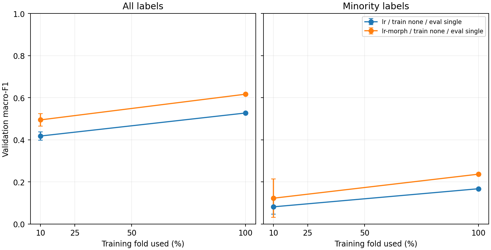

# What do shape and texture add on a grouped split?

The grouped baseline describes an image using 104 color, intensity, edge and spatial features. We kept that pipeline and added 31 measurements from the same RGB image. On the same 2,690 validation images, full-training macro-F1 increased by **0.0894**. With 10% of the training labels it improved in each of three paired runs.

| Full-training model, original orientation | Macro-F1 · 35 classes | Macro-F1 · 9 minority classes | Accuracy |
| --- | ---: | ---: | ---: |
| Original `main` implementation refit on these folds | 0.5253 | 0.1621 | 75.54% |
| Grouped LR control, 104 features | 0.5275 | 0.1677 | 70.45% |
| Grouped LR + shape and texture, 135 features | **0.6169** | **0.2369** | **79.89%** |

The two grouped rows isolate the feature change. Both use the same training images, 128 px canvas, training-only scaling, balanced class weights, L2 logistic regression (`C=1`), original orientations and single-view inference. The `main` row is a separate reference that retains its own preprocessing, HOG features, unweighted loss and `C=0.1`. Every row uses predictions from a newly fitted model.

## The added measurements

At each of three fixed grayscale thresholds (12, 40 and 96 on a 0–255 scale), the new descriptor measures foreground area, two principal-axis spreads, their ratio, exposed border length, compactness and the 90th percentile of distance from the foreground centroid. Ten further bins count local brightness patterns around foreground pixels. Rotating or reflecting the square canvas preserves these 31 measurements. The entire classifier also uses the original spatial features, so its predictions can still change with orientation. Training uses pixel values alone. File names and timestamps identify fold membership.

## Limited labels and rotations

| Same 1,256 training images within each pair | Control macro-F1 | With added features | Paired change |
| --- | ---: | ---: | ---: |
| Seed 464 | 0.4316 | 0.4952 | +0.0636 |
| Seed 465 | 0.4269 | 0.5241 | +0.0973 |
| Seed 466 | 0.3962 | 0.4652 | +0.0691 |
| Mean (sample SD across training subsets) | 0.4182 (0.0192) | 0.4948 (0.0295) | +0.0766 |

The three subsets share one validation fold. In the full-data pair, 28 classes gained F1, four tied and three lost F1. For example, `polyarthra` dropped by 0.0974 with 15 validation images. The nine minority labels were selected from full-training class counts before scoring. Their macro-F1 also dropped slightly in the 10% seed-466 pair, from 0.0414 to 0.0376. Some classes have as few as three validation examples.



In a follow-up check we rotated each validation canvas through exact quarter turns and scored each view separately with the two fitted full-data models. At 90°, macro-F1 changed from 0.5262 for the control to 0.6249 for the extended model. Agreement with the same model's original prediction rose from 77.36% to 84.20%. The lowest macro-F1 across the four measured angles was 0.4919 and 0.5962, respectively. These checks cover multiples of 90° and use no prediction averaging.

## Which holdout was used?

The parent branch committed a split summary and a run hash. Its full image-to-fold manifest was generated locally. Re-running its grouped splitter on Windows with the pinned scientific packages produced identical fold sizes but different block assignments. The parent's historical **0.5122** and the original provider-split **0.5568** therefore describe different evaluations.

We used the first locally generated grouped split and froze all **6,162 three-minute blocks**. After quarantining six conflicting duplicate files there are **12,556 train / 2,690 validation / 2,691 test** images. Decoded hashes, camera frames and three-minute blocks are disjoint across partitions. Grouping can still place adjacent blocks from one capture session into different partitions. All model comparisons on this page use validation. The test fold was used only for dataset inventory and assignment checks. Its membership is specific to this experiment.

The checked-in fold map recreates every image assignment and every nested subset used here, independently of the platform's integer solver. We verified both against the manifest used for training. We also recomputed the scores from saved predictions and reloaded the full grouped models to reproduce all original-orientation validation labels.

- [Frozen group-to-fold map](folds.csv)
- [All nine baseline and model runs](paired_scores.csv) · [F1 and support for every class](per_class_full.csv)
- [Metrics and agreement at every measured angle](quarter_turn_scores.csv) · [One row per validation image with predictions](validation_predictions.csv)

## Reproduce from Windows CMD

Run from the repository root with Python 3.12 or 3.13 and an active virtual environment. Set the data path to the extracted Eawag archive directory that contains the `data` folder. The grouped training commands below use the branch's pinned packages. This experiment ran on Python 3.12.14, NumPy 2.2.5, SciPy 1.17.0 and scikit-learn 1.8.0.

```cmd
cd zoolake-grouped
python -m pip install -r requirements.txt
set "ZOOLAKE_DATA_ROOT=C:\datasets\zoolake"
python -m zoolake audit
python -m zoolake split --fold-map results/morphology/folds.csv
for %M in (lr lr-morph) do python -m zoolake train --model %M --fraction 100 --seed 464 --augment none --no-tta --out artifacts/runs/%M-100-464
for %S in (464 465 466) do for %M in (lr lr-morph) do python -m zoolake train --model %M --fraction 10 --seed %S --augment none --no-tta --out artifacts/runs/%M-10-%S
for %M in (lr lr-morph) do python report/quarter_turns.py --run artifacts/runs/%M-100-464 --split artifacts/splits/splits.json --data-root "%ZOOLAKE_DATA_ROOT%" --out artifacts/runs/turns-%M.csv
python -m unittest discover -s tests -v
```

To reproduce the optional `main` reference, switch to an environment installed from `legacy-provider-split/requirements.txt`. From `zoolake-grouped`, run the following using the same extracted data and split.

```cmd
python report/main_on_grouped.py --data-root "%ZOOLAKE_DATA_ROOT%" --split artifacts/splits/splits.json --out artifacts/runs/main.csv
```
